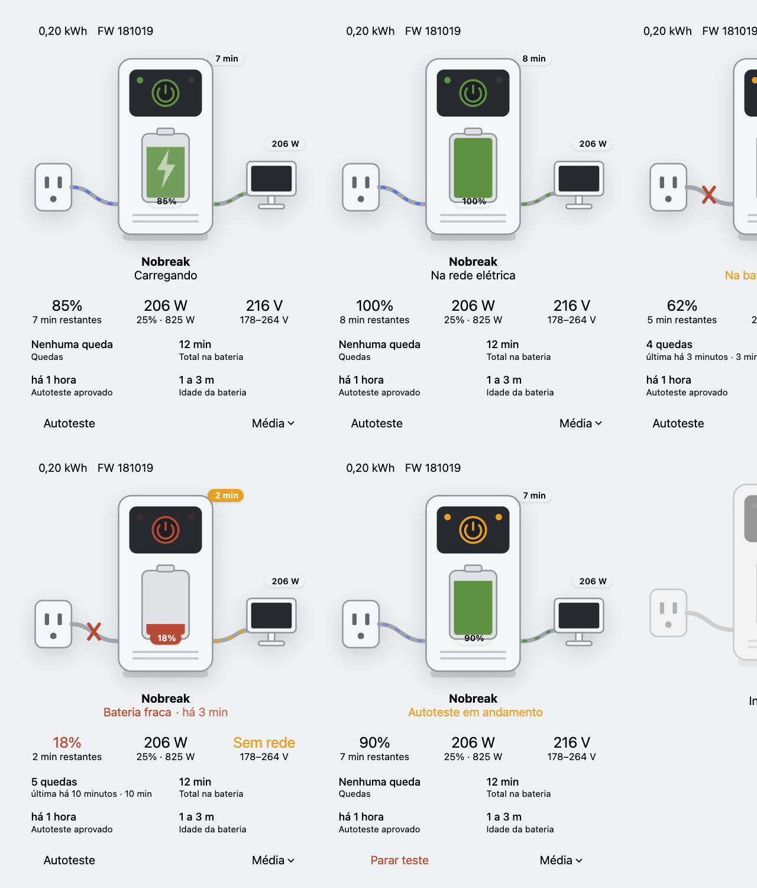

# Nobreak Card

[](https://hacs.xyz)
[](https://github.com/hudsonbrendon/ha-card-nobreak/releases)
[](https://github.com/hudsonbrendon/ha-card-nobreak/actions/workflows/lint.yml)

Animated Lovelace card for a UPS (nobreak) through the
[Nobreak (NUT)](https://github.com/hudsonbrendon/ha-nobreak) integration,
reading the live values from the core **Network UPS Tools** device it is
connected via. Same layout and grey/white drawing as the vacuum, HP printer,
MiSTer and Bambu cards.



- **Drawing**: wall outlet → UPS tower → monitor, with the battery window
  filled to the real charge. On utility the power flows in and out; charging
  shows a bolt; on battery the input is cut and the output turns orange;
  low battery, overload and scheduled shutdown blink red; self-test blinks
  amber.
- **Status**: online, charging, on battery (and for how long), low battery,
  self-test, overload, shutdown scheduled, unavailable.
- **Stats**: battery % and runtime left, output power (W, load % of nominal),
  utility voltage with the transfer range (or *No power*).
- **History**: outages (count, last one and its duration), total time on
  battery, last self-test and result, battery age.
- **Toolbar**: quick self-test, deep self-test (with confirmation), front panel
  test, stop test while one runs, cancel a scheduled shutdown, mute while on
  battery, enable/disable the alarm, input sensitivity.
- **Tips**: replace battery, AVR active, alarm disabled, output energy,
  firmware.
- Entities are found by the integrations' `translation_key`, so it works in
  any Home Assistant language. Visual editor, entity suggestion, en + pt-BR,
  dark mode, `prefers-reduced-motion`.

## Install

HACS → Frontend → ⋮ → *Custom repositories* → add
`https://github.com/hudsonbrendon/ha-card-nobreak` as *Dashboard*, then install
**Nobreak Card**. Manual: copy `dist/nobreak-card.js` to `/config/www/` and add
it as a JavaScript module resource.

Requires the [Nobreak (NUT)](https://github.com/hudsonbrendon/ha-nobreak)
integration (2026.11+: its device is linked to the NUT one with
"connected via").

## Configuration

```yaml
type: custom:nobreak-card
device: <nobreak device id>   # pick it in the visual editor
# name: Nobreak
# show_name: true
# show_status: true
# show_history: true
# show_toolbar: true
# compact_view: false
# entities:                   # optional overrides, by card key
#   charge: sensor.my_ups_battery_charge
```

## Development

```bash
npm ci
npm run lint && npm run typecheck && npm test
npm run build   # dist/nobreak-card.js
```

## License

MIT
